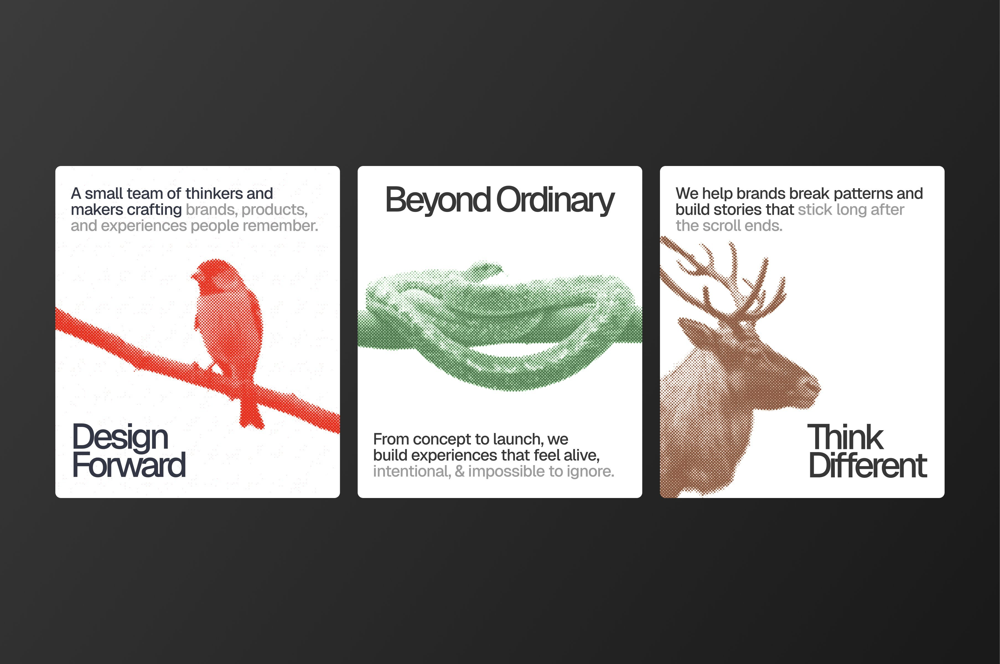

# Website design decisions

Use this record when changing the composition. Follow the
[website workflow](README.md#review-a-change) for visual review and the
[review standards](../../CODING_STANDARDS.md) for completion criteria.

## Visual foundation

Translate the reference's halftone ink, paper, and confident typography into
Quill's own composition. Warm paper, charcoal type, restrained rust-red artwork,
and local Geist fonts form the palette. Exact values belong in
[`assets/site.css`](../../assets/site.css); halftone rendering belongs in
[`assets/print-fields.js`](../../assets/print-fields.js). Geist Mono supports
code and small labels.

## Composition

- Explain the product in plain language: a Rust compiler aiming for full
  compatibility on Linux and Windows. Distinguish that goal from present support.
- Keep hero copy left aligned and the compact, vertical getting-started section
  to its right on desktop. Use the small flame-feather mark in navigation and
  the footer; the large hero feather was removed.
- Separate sections with equally compact halftone impressions aligned to the
  content container. Their wave motion should be slow and subtle, with a
  stationary treatment for reduced motion.
- Keep useful content close together. Give headings, explanations, and evidence
  a readable hierarchy without oversized empty columns or decorative labels.
- Keep measured performance beside its provenance. Present build speed,
  generated-binary runtime, and LSP latency as distinct measurements.
- Separate documented feature status from differential compiler-check evidence.

## Current baseline

Architecture uses a text-based Parse / Check / Generate / Link interaction.
Inspiration pairs halftone language names with concise research notes. The LSP
section explains editor support and measured latency. These are starting points
for scoped changes, not permanent approval of every detail.

## Previous explorations

The reference's animals, knot, and three-card arrangement were style examples,
not requested motifs. Arbitrary animals and abstract shapes, printing presses,
factory scenes, generic feature-card grids, large hero feathers, and the
“Taking shape” section were rejected or removed. Tinted section bands and lone
straight rules also failed as the main section separators. Carry those decisions
forward unless the user explicitly changes direction.
